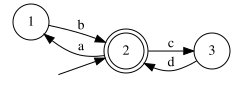

# RegexSolver

[](https://crates.io/crates/regexsolver)
[](https://docs.rs/regexsolver)
[](https://github.com/RegexSolver/regexsolver/actions/workflows/rust.yml)
[](LICENSE)
[](#install)

The `regex` crate tells you whether a *string* matches a pattern. **RegexSolver treats patterns as the sets of strings they match**, so you can intersect, subtract, compare, complement and enumerate them, and get the result back as a regex.

```rust
use regexsolver::{Term, fast_automaton::PathOrder};

let a: Term = "(ab|xy){2}".parse().unwrap();
let b: Term = ".*xy".parse().unwrap();

// Which strings match BOTH patterns? Get the answer as a regex:
let both = a.intersection([&b]).unwrap();
assert_eq!(both.to_pattern().unwrap(), "(ab|xy)xy");

// Test a concrete string against the result (matching is anchored):
assert!(both.matches("abxy").unwrap());

// ...and sample them:
assert_eq!(both.generate_strings(2, 0, PathOrder::Sweep).unwrap(), ["xyxy", "abxy"]);
```

## Use cases

- **Safe migrations**: `old.subset(&new)?` tells you whether a new validation pattern accepts *everything* the old one did.
- **Equivalence proofs**: `a.equivalent(&b)?` shows that two patterns match the same strings.
- **Rule analysis**: `intersection` and `difference` find shadowed or overlapping routes, firewall rules and validators.
- **Test data**: `generate_strings` produces strings that match a pattern, spread over the cases it allows, reproducible and pageable.
- **Input bounds**: `length()` gives the shortest and longest string a pattern matches, to size a database column.
- **Readable regexes**: every result converts back to a pattern, and [neural synthesis](#neural-synthesis) can make it simpler.

## Install

```bash
cargo add regexsolver
```

| Feature | Adds |
|---|---|
| `parallel` (default) | Runs large unions and intersections, and neural synthesis inference, on [rayon](https://crates.io/crates/rayon). No effect on `wasm` targets. |
| `neural-synthesis` | [Neural synthesis](#neural-synthesis), with models loaded from their files. |
| `neural-synthesis-hub` | Model downloads from the Hugging Face Hub. Needs Rust 1.95, not available on `wasm` targets. |
| `neural-synthesis-cuda`, `-cudnn`, `-metal` | GPU inference. Needs the CUDA toolkit (and cuDNN) or Metal. |
| `neural-synthesis-mkl`, `-accelerate` | Faster CPU inference. Needs oneAPI MKL's static libraries or Apple Accelerate. |

`regexsolver` builds with Rust 1.88 and later, verified in CI. Raising this version is a breaking change.

## Examples

```bash
git clone https://github.com/RegexSolver/regexsolver && cd regexsolver

# How do two patterns relate? (equivalence, subsets, intersection, differences)
cargo run --example relate -- "(ab|xy){2}" ".*xy"

# Generate 20 strings matching a pattern
cargo run --example generate -- "[a-z]{2}[0-9]" 20

# Compare state elimination and neural synthesis
cargo run --release --features neural-synthesis-hub --example neural_synthesis
```

## Semantics

RegexSolver works on **regular languages**, and differs from typical regex engines in two ways:

- **Everything is anchored**: `abc` matches the string "abc", not "xabc" or "abcx". A pattern describes *whole strings*.
- **`.` matches any character**, including line feed (`\n`).

Constructs a regular language can't express, such as backreferences, lookaround, inline flags and word boundaries, return an `EngineError` instead of changing what the pattern means. The [crate documentation](https://docs.rs/regexsolver/latest/regexsolver/#semantics) covers each case.

## API

[`Term`](https://docs.rs/regexsolver/latest/regexsolver/enum.Term.html) is the type you work with: it holds a regular expression or an automaton, and picks the representation each operation needs.

| | Methods |
|---|---|
| Build | `from_pattern`, `parse`, `concat`, `repeat` |
| Combine | `union`, `intersection`, `difference`, `complement` |
| Compare | `equivalent`, `subset`, `matches` |
| Analyze | `is_empty`, `is_total`, `length`, `cardinality` |
| Generate | `generate_strings`, `iter_strings` |
| Convert | `to_pattern`, `to_regex`, `to_automaton`, `determinize`, `minimize` |

For lower-level work, [`FastAutomaton`](https://docs.rs/regexsolver/latest/regexsolver/fast_automaton/struct.FastAutomaton.html) builds and inspects automata state by state, and [`RegularExpression`](https://docs.rs/regexsolver/latest/regexsolver/regex/enum.RegularExpression.html) exposes the parsed pattern as an AST.

Automaton operations can blow up on adversarial patterns. To run untrusted input, set limits on run time and number of states with an [`ExecutionProfile`](https://docs.rs/regexsolver/latest/regexsolver/execution_profile/struct.ExecutionProfile.html): hitting one returns an `EngineError` instead of hanging.

## Neural synthesis

`to_pattern` converts an automaton back to a pattern by state elimination. The result is always correct, but often hard to read. With the optional `neural-synthesis` feature, `to_regex_with` asks a learned model for a simpler pattern:

```rust,ignore
use regexsolver::{Term, neural_synthesis::{Device, NeuralSynthesizer}};

// Downloads the default model from the Hugging Face Hub (`neural-synthesis-hub` feature).
let synthesizer = NeuralSynthesizer::from_hub(NeuralSynthesizer::DEFAULT_HUB_MODEL, Device::best_available())?;
// With `neural-synthesis` alone, load the model files (config.json, model.safetensors) from a directory:
// let synthesizer = NeuralSynthesizer::from_dir("kleene2-9m-b16-t128", Device::best_available())?;

// Words ending in "ing", except those ending in "ring":
let ing: Term = "[a-z]*ing".parse()?;
let ring: Term = "[a-z]*ring".parse()?;
let words = ing.difference(&ring)?;

words.to_pattern()?;                 // [a-qs-z]*(i|r((i?|ing?|([a-hj-qs-z]|i[a-mo-qs-z]|in([a-fh-qs-z]|g[a-qs-z]))[a-qs-z]*)r)*(i{2}|ing?i|([a-hj-qs-z]|i[a-mo-qs-z]|in([a-fh-qs-z]|g[a-qs-z]))[a-qs-z]*i))ng
words.to_regex_with(&synthesizer)?;  // ([a-z]*[a-qs-z])?ing
```

Every pattern the model proposes is checked against the automaton, so the result is never wrong. If none is simpler, the state-elimination pattern is returned.

The models are on Hugging Face: [`kleene2-9m-b16-t128`](https://huggingface.co/alexvbrdn/kleene2-9m-b16-t128) (default), [`kleene2-5m-b16-t128`](https://huggingface.co/alexvbrdn/kleene2-5m-b16-t128) and [`kleene1-9m-b16-t128`](https://huggingface.co/alexvbrdn/kleene1-9m-b16-t128). The [`neural_synthesis` documentation](https://docs.rs/regexsolver/latest/regexsolver/neural_synthesis/index.html) covers the models, devices and performance.

## How it works

<p align="center"></p>
<p align="center"><sub>The minimal automaton for <code>.*abc.*def.*</code> (text containing <code>abc</code> then <code>def</code>), rendered from this library's <code>to_dot()</code>.</sub></p>

- Patterns are parsed with [regex-syntax](https://docs.rs/regex-syntax/latest/regex_syntax/) into a small regular-expression AST, set operations run on finite automata like the one above, and results convert back to patterns by state elimination.
- Transition labels are bitvectors over a per-automaton set of disjoint character ranges, making label union, intersection and complement O(1): see [Optimizing Automaton Representation with Transition Conditions](https://alexvbrdn.me/post/optimizing-transition-conditions-automaton-representation).
- Correctness is cross-validated against the `regex` crate, and checked by property-based tests over random automata and expressions with brute-force oracles.

## Contributing

Bug reports and pull requests are welcome, see [CONTRIBUTING.md](CONTRIBUTING.md). Changes are recorded in [CHANGELOG.md](CHANGELOG.md), and the security policy is in [SECURITY.md](SECURITY.md).

## License

Licensed under the [MIT License](LICENSE).
